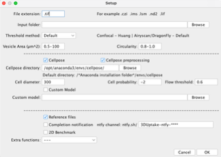
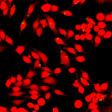
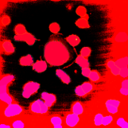

# 3DUptake User Manual

## Table of Contents
- [Introduction](#introduction)
- [Experimental workflow](#experimental-workflow)
- [Installation](#installation)
- [Setup cellpose parameter](#setup-cellpose-parameter)
- [Running the 3DUptake Fiji Macro](#running-the-3duptake-fiji-macro)
- [Output structure](#output-structure)
- [Key considerations](#key-considerations)
- [Quality check](#quality-check)
- [Troubleshoot](#troubleshoot)

## Introduction

### Hardware requirements
Compatible with Windows/Linux/MacOS

- CUDA is recommended to accelerate Cellpose segmentation.
- Apple silicon GPU supported with Metal Performance Shaders (MPS).

### Acquisition requirements
Confocal microscopy – high-speed oriented microscope is recommended.

### Required software
- [Fiji](https://fiji.sc)/[ImageJ](https://imagej.net/ij/)
- [Cellpose](https://github.com/mouseland/cellpose)
- Python environment ([miniforge](https://github.com/conda-forge/miniforge), [Anaconda](https://anaconda.org/anaconda/python), or python [venv](https://docs.python-guide.org/dev/virtualenvs/#lower-level-virtualenv))
- [BIOP Wrapper for Fiji](https://github.com/BIOP/ijl-utilities-wrappers)

### Tested versions
- Fiji 1.54p and later
- Cellpose v4.2
- Python 3.9–3.12

## Experimental workflow

### Cell setup protocol
Protocol can be found on Protocol.io:
https://www.protocols.io/view/3duptake-kqdg3mj9el25/v1

## Installation

### Install python environment
* [Miniforge](https://github.com/conda-forge/miniforge)
* [Anaconda](https://www.anaconda.com/download)
* [Python venv](https://docs.python-guide.org/dev/virtualenvs/#lower-level-virtualenv)

>    The following tutorial demonstrates installation and use using miniconda or Anaconda.

### Install [Fiji](https://fiji.sc/)


### Install [BIOP Wrapper](https://github.com/BIOP/ijl-utilities-wrappers)

1. **Fiji** → **Help** → **Update...**
2. **Manage Update Sites** → Search for **BIOP** → Enable **PTBIOP**
3. **Apply and Close** → **Apply Changes**


### Install Cellpose 4
>	Official and latest installation method can be found on [Cellpose official repository](https://github.com/mouseland/cellpose)

Open a terminal window (**Command prompt** or **Terminal**)
1. Create a new conda environment:
```bash
conda create --name cellpose python=3.12
```
>   The environment name (cellpose) can be customised

2.	Activate conda environment:
```bash
conda activate cellpose
```

3.	Install cellpose 4 (tested upto cellpose 4.0.4):
```bash
pip install cellpose
```

4.	Install cellpose GUI (graphical user interface):
```bash
python -m pip install 'cellpose[gui]'
```

-	Apple silicon may need to install pytorch to enable GPU support, more info [here](https://pytorch.org/get-started/locally/).
```bash
pip3 install torch torchvision
```


### Install the [3DUptake macro](https://github.com/StuartShenUQ/3DUptake/tree/main/Releases)

1. Download the [3DUptake archive](./3DUptake.zip)
2. Extract the ZIP archive
3. Copy the folder to *Fiji installation folder*/scripts/Plugins
4. Restart Fiji

The 3DUptake should now be accessible from the **Fiji** → **Plugins** → **3DUptake** dropdown menu

## Setup cellpose parameter

```bash
conda activate cellpose
python -m cellpose
```

### Prepare sample image(s) for testing:

1. Open a test Z-stack image in Fiji
2. **Plugins** → **3DUptake** → **Generate Test Image**
3. Save the “AVG_Test_Image” image as test image for optimising the Cellpose parameters.

###Launch the Cellpose GUI

Open a terminal window (**Command prompt** or **Terminal**)
```bash
conda activate cellpose
python -m cellpose
```

> [!Note]
> In cellpose GUI, on the left panel, under **Segmentation**, make sure Cellpose have access to GPU accleration.
> 1. Make sure **use GPU** is checked
> 2. Terminal windows prints:
>
>       ** TORCH CUDA version installed and working. **
>
>       or [INFO] ** TORCH MPS version installed and working. **

**In the Cellpose GUI:**
1. **File** → **Load image** (*.tif, *.png, *.jpg)
2. In the **Segmentation** section on the left panel, **expand** the **additional settings** tab

**Recommended starting parameters:**
- Diameter: 200–300
- Flow threshold: 0.6
- Cellprob threshold: -2 to -4

> [!NOTE] Test both the origianl 3D image and the AVG_Test_Image and note the one that yield better Cellpose segmentation

## Running the 3DUptake Fiji Macro

In Fiji:

**Plugins** – **3DUptake** – **3DUptake**
-	If there is any opened window, save the needed files, then click ‘OK’

**3DUptake Fiji Macro setup interface**



- [**File extension**]: Input the image format.
  - Opening non .tiff file will use BioFormat importer windowless during the macro.
- [**Input folder**]: Click ‘Browse’ to choose the directory containing the dataset.
- [**Threshold method**]: Use ‘Default’ threshold method for initial testing, if the threshold is unsuitable for the dataset during [Quality Check](#quality-check), the use of other method is supported. (Prioritise Huang if Default is unsuitable).
- [**Vesicle Area (µm^2)**]: Input the area size range for the object of interest. For macropinosomes, start with 0.5-100
- [**Circularity**]: Input the roundness filter for the target object. For circular vesicles, start with 0.8-1.0

---

- [**Cellpose**]: Use Cellpose for cell segmentation. Optional for analysis on the entire FoV.
- [**Cellpose preprocessing**]: Preprocess the images before Cellpose segmentation, optionally uncheck this option if the original 3D test data produced better segmentation. For additional information, check [Setup Cellpose parameters](#setup-cellpose-parameter). 
- [**Cellpose directory**]: Input the directory for the cellpose environment. The default directory will be populated for Windows and MacOS
- [**Cell diameter**], [**Cell probability**], [**Flow Threshold**]: Input the optimised cell diameter, cell probability, and flow threshold. Determine the optimised parameters using Cellpose GUI as shown in [Setup Cellpose parameters](#setup-cellpose-parameter).
- [**Custom Model**]: User can train their custom Cellpose model using the Cellpose GUI human-in-the-loop training. User can check this option and select the path to their custom model.

---

- [**Reference files**]: Strongly recommended. This option automatically produces visual quality check files. 
  - Reference files are structured with CH1 (red): cell body, CH2 (green): vesicles, and CH3 (blue): cellpose segmentation.
  - Reference files are located in: /Input directory/References_*macro version*_*date*/
- [**Completion notification**]: Option to receive push notification when the macro finishes. Push notifications (mobile app or browser notification) are sent through open-sourced service ntfy.
  - Details can be found on the ntfy [offical website](https://ntfy.sh/).
  - Subscribe to the default ntfy channel 3DUptake-ntfy-**** (4 digits code will be randomly generated the first time this macro is started on each Fiji copy). Same Fiji installation will reuse the same channel on subsequent runs.
  - User can choose their own ntfy channel duing the setup and the channel will be saved for subsequent analysis on the same Fiji build.
- [**2D Benchmark**]: Comparing 3D and 2Danalysis. When enabled, the macro will extract the **second slice** and **slice at 40% of the stack** (representing bottom and middle of the cells), before the slices are *SUM intensity projected* and measured. The single slice will be analysed with the same method as the 3D and generating comparable spreadsheets and reference files in the output folder.
> [!IMPORTANT]
> This feature needs to be used with cellpose enabled.
-	[**Extra functions**]: These functions apply to edge cases unique to the systems used to develop this macro.
  - “Airyscan border removal” will remove black borders generated by Zen Black during Airyscan processing.
  - “Dragonfly de-noise” removes the bottom-most and 2 top-most slices from the input dataset. This function was specifically designed if the threshold of the input is incorrect due to high background – see troubleshoot

Click [**OK**] once the setup is finished. The log windows will be updated with a progress bar, and the notification and finishing prompt will be sent once the macro is finished.

## Output structure

```text
Input directory/
└── Output/
    ├── Results_version_date_time.csv
    ├── 2D_Analysis_version_date_time/
    │   ├── Result_low_version_date_time.csv
    │   ├── Result_mid_version_date_time.csv
    │   └── 2D_Summary_input file name.tif
    └── Reference_version_date_time/
        ├── log.txt
        └── Summary_input file name_date_time.tif
```

- Result_*version_date_time*.csv: Main result output
- Log.txt: Summary of run parameters
- Summary_*input* *file* *name_date_time*.tif
- Result_low_*version_date_time*.csv: 2D analysis of the second slice of the 3D stack
- Result_mid_*version_date_time*.csv: 2D analysis of the slice at 40% of the 3D stack
- 2D_Summary_*input* *file* *name*.tif: Quality check images for 2D benchmark

## Key considerations

### 1. Signal-to-noise ratio (SNR)
The SNR calculation for image captured with shadow imaging technique depends on which part of the image is considered ‘background’. If the dark cell body shadow is considered as the background, the SNR will need to be more than 20. Alternatively, if the fluorescent medium is considered as the background, it will typically need a SNR of 15 for successful and consistent threshold segmentation in Fiji. 

### 2. Cell density
Smaller cells and more cells in a field make it easier to acquire larger dataset for the experiment. With the latest version of cellpose 4 with cpsam model, densely packed adhering cells can be segmented cleanly. For our testing we seeded the cells at 0.1 M mL-1 and the RAW264.7 macrophages doubles overnight, and the final density is around 50 cells per FOV (40 after removing cells touching the boundary). The Andor Dragonfly system we used in this study has a FOV of 208 x 208 µm2 when using a 60x objective and 1x camera magnification, a FOV with a fully confluent adherent cell layer of more than 100 cells can be segmented.

### 3. Acquisition speed
The acquisition for each stack should be kept as fast as possible. We highly recommend high-speed oriented system such as a spinning-disc confocal microscope for this workflow. Alternatively, other fast acquisition techniques such as fast Airyscan, or using resonant scanners are compatible as well. Using spinning-disc confocal microscopy each 3D image can be captured in around 5 s at Nyquist sampling rate (0.18 µm optical section thickness). However, optical section can be optimised to improve speed, see point 6.

### 4. Total acquisition duration
With high-speed microscope, a 3D image typically takes around 5 s to collect. Between each acquisition the user will need to find a new random position and adjust the Z coordinates for imaging. The time to locate and adjust for the new FOV determines the total number of FOVs that can be acquired within the uptake window. Therefore, the interval needs to be minimised. Generally, the interval between each 3D image was kept below 30 s to achieve a total of 20 acquisitions over 20 mins during early macropinocytosis.

To maximise the sample size within the set duration, the user can set multiple positions or use tiling for acquisition, however, we found multiple acquisition needs substantial amount of time during post-process to produce clean result. The specific interval between the first and last acquisition depends on the cell type. We recommend user to observe the endocytic traffic of cargo before set time interval for analysis.

### 5. Z-scanning range
When capturing dataset using shadow imaging technique, set the bottom of the cell at the Z-plane where the cell is **completely in focus**, out-of-focus slice greatly affect the threshold consistency. Similarly, set the top of the Z-stack before the of the cell disappears, see examples below. Do ensure that when setting the Z-scanning range to not include Z-planes containing only medium and no cell shadows. 

### 6. Optical section thickness
Thinner optical sections can produce more detailed measurements, but compromise imaging time. With spinning-disc confocal microscope scanning at Nyquist sampling rate is generally not an issue. When using scanning confocal microscope, consider lowering the scanning resolution, using thicker optical section, or using lower pixel dwell time to maximise speed.


## Quality check
- Go to the reference file directory (/input directory/References_*version*_*date*)
> [!TIP]
> Reference files have corresponding name as the original input image, with “Summary_” prefix

- Verify threshold quality
  - Correct threshold should preserve most of the cell boundary without high background.
  - Good threshold:

    

  - Background too high:

    

  > Fix:
  > 1. Try other threshold method
  > 2. Check if the **bottom** slice(s) is **completely in focus**
  >
  >     * Trim the first slice and see if the threshold improves

- Noise in the vesicle mask
  - Load the Reference images
  - Go to Channel 2 (green)
  - In Fiji → Brightness/Contrast → Set
  - Set the *Minimum displayed value* and *Maximum displayed value* to 1
  - Inspect false positive veiscles

  > Fix:
  > 1. Try other threshold method
  > 2. Check if the **top** slice(s) is **completely in focus**
  >
  >     * Trim the top slice and see if the threshold improves

## Troubleshoot

### Cellpose directory not found
Default locations:

**Windows**
```text
C:\\Users\\<username>\\Anaconda3
```

**macOS**
```text
/opt/anaconda3/envs/<cellpose-environment>
```

**Linux**
```text
/opt/anaconda3/envs/<cellpose-environment>
```